# Mapa Maestro de Navegación: Lark Player (`com.dywx.larkplayer`) vs. Melody (`com.example.melody`)

> Documento generado mediante ingeniería inversa estática con **REA / JADX** sobre `C:\Users\yahir\APK_An\apk\extracted\base.apk` (`com.dywx.larkplayer`). Sirve como plano arquitectónico y hoja de ruta funcional para **Melody**.

---

## 1. Estructura Principal (`MainActivity`, Cabecera y Pestañas Raíz)

### 1.1 Contenedor Raíz (`com.dywx.larkplayer.main.MainActivity`)
`MainActivity` (que extiende `BaseMusicActivity`) actúa como actividad anfitriona única del flujo principal sobre el contenedor `R.id.content`. En el método `MainActivity.u0(Intent, String)`, enruta dinámicamente entre tres fragmentos raíz según el estado de la aplicación:

1. **`"guide_storage"` → `com.dywx.v4.gui.fragment.StorageGuideFragment`**: Se muestra cuando la app aún no cuenta con los permisos de lectura de almacenamiento/audio (`READ_MEDIA_AUDIO` / `READ_EXTERNAL_STORAGE`).
2. **`"new_welcome"` → `WelcomeFragment` (y `LanguageActivity`)**: Flujo de bienvenida y selección inicial de idioma en el primer arranque.
3. **`"main_pager"` → `com.dywx.larkplayer.main.MainFragment`**: Contenedor principal de la aplicación (infla `R.layout.fragment_main_motion`).

### 1.2 Cabecera Principal (`com.dywx.larkplayer.module.base.widget.MainHeadView`)
Ubicada en la parte superior de `MainFragment` (`R.id.head_root`), contiene el logotipo animado (`img_logo`, `img_title`) y tres acciones globales de navegación:
- **Buscar (`R.id.search_btn`)**: Abre el flujo de búsqueda local (`com.dywx.v4.gui.fragment.LocalSearchFragment` y `SearchContentFragment`) alojado en `ContainerActivity`.
- **Ordenar (`R.id.btn_sort`)**: Invoca `MainFragment.R()`, que abre `com.dywx.v4.gui.fragment.bottomsheet.SortBottomSheetFragment` pasando como argumento la clave de la pestaña activa (`"songs"`, `"main_playlist"`, `"audio_folders"`, `"artists"`, `"albums"` o `"videos"`).
- **Ajustes (`R.id.btn_setting`)**: Abre `com.dywx.v4.gui.fragment.SettingsFragment` dentro de `ContainerActivity`.

### 1.3 Pestañas Principales y Sub-Pestañas de Audio (`MainFragment` + `ViewPager`)
En lugar de una barra inferior de pestañas tradicional, `MainFragment` reserva la franja inferior para el **Mini-Reproductor persistente** (`R.id.mini_player`) y estructura toda la biblioteca mediante una **barra horizontal de pestañas/chips (`R.id.tab_layout`, gestionada por `o.ld8`)** sincronizada con un **`ViewPager` (`R.id.view_pager`, adaptador `o.c25`)**.

Cada página del `ViewPager` está envuelta en una instancia de `com.dywx.v4.gui.fragment.MainContentFragment`, la cual carga de forma perezosa (`BaseLazyFragment` en `o.y05.invoke`) uno de los **6 fragmentos principales**:

| Índice | Clave (`key_tab`) | Etiqueta en UI | `Fragment` Real Cargado | Sub-navegación / Detalle al tocar un elemento |
| :---: | :--- | :--- | :--- | :--- |
| **0** | `"Video"` | **Videos** (`R.string.videos`) | `com.dywx.v4.gui.fragment.SearchBarVideoGridFragment` | Reproductor de video / `VideoFolderDetailFragment` |
| **1** | `"Music"` | **Canciones** (`R.string.songs`) | `com.dywx.larkplayer.gui.audio.songlist.SongsOptimizeFragment` *(o `SongsFragment`)* | Inicia reproducción en `MotionAudioPlayerFragment` |
| **2** | `"Playlists"` | **Playlists** (`R.string.playlists`) | `com.dywx.v4.gui.fragment.MainPlaylistFragment` | Abre `LikedPlaylistFragment`, `OfficialPlaylistFragment`, `LyricsPlaylistFragment` o `LocalPlaylistFragment` en `ContainerActivity` |
| **3** | `"Folder"` | **Carpetas** (`R.string.folders`) | `com.dywx.v4.gui.fragment.AudioFolderFragment` | Abre `com.dywx.v4.gui.fragment.AudioFolderDetailFragment` en `ContainerActivity` (con acceso a `AudioScanFilesFragment`) |
| **4** | `"Artists"` | **Artistas** (`R.string.artists`) | `com.dywx.larkplayer.gui.audio.MainAudioArtistFragment` | Abre `com.dywx.v4.gui.fragment.ArtistPlaylistFragment` (`o.lw5.j`) en `ContainerActivity` |
| **5** | `"Albums"` | **Álbumes** (`R.string.albums`) | `com.dywx.larkplayer.gui.audio.MainAudioAlbumFragment` | Abre `com.dywx.v4.gui.fragment.AlbumPlaylistFragment` en `ContainerActivity` |

---

## 2. Flujo del Reproductor (`MotionAudioPlayerFragment` y `PlayerDetailsActivity`)

### 2.1 Interacción entre el Mini-Reproductor Persistente y la Vista Expandida
Lark Player unifica el Mini-Reproductor y el Reproductor Expandido dentro de una misma clase: **`com.dywx.v4.gui.fragment.MotionAudioPlayerFragment`** (subclase de `com.dywx.v4.gui.fragment.PlayerFragment`), gobernada por un `LPMotionLayout` (`R.id.motion_layout`):

1. **Modo Incrustado en `MainFragment` (Controlador `o.cp5`)**:
   - `MainFragment` declara en su parte inferior un contenedor `PopulateFragmentFrameLayout` (`R.id.mini_player`).
   - El helper `o.cp5` instancia `MotionAudioPlayerFragment` dentro de `R.id.mini_player` pasando `key_init_state = getMiniBarHeight()`.
   - **En estado colapsado (Mini-Reproductor, `R.id.mini_background`)**: Muestra un carrusel horizontal de carátulas (`carousel_previous_mini`, `carousel_next_mini`), título en marquesina (`tv_title`), botón de modo de repetición (`action_mode_mini`), botón de favorito (`action_like_mini`), pista anterior (`action_pre_mini`), botón Play/Pause rodeado por un anillo de progreso circular (`action_play_mini` + `progress_mini_circular` de tipo `CircleRingProgress`) y pista siguiente (`action_next_mini`).
   - **Transición a Vista Expandida (`o.cp5.a(true, ...)`):** Al tocar el Mini-Reproductor o deslizarlo hacia arriba, `o.cp5` cambia dinámicamente el `layoutParams.height` del contenedor a `MATCH_PARENT` (`-1`), ejecuta la transición de `LPMotionLayout` hacia el estado expandido a pantalla completa y oculta la barra de estado del sistema.
2. **Modo Actividad Dedicada (`com.dywx.v4.gui.PlayerDetailsActivity` y `LandscapePlayerDetailsActivity`)**:
   - Cuando el usuario abre el reproductor desde una pantalla secundaria alojada en `ContainerActivity` (por ejemplo, dentro del detalle de un Álbum, Artista, Carpeta o Playlist), desde un widget o desde un `Intent` externo de audio, se lanza `PlayerDetailsActivity` con la animación `R.anim.slide_in_bottom`.
   - `PlayerDetailsActivity.m0()` incrusta `MotionAudioPlayerFragment` directamente en `R.id.content` con `key_init_state = -1` (directamente expandido).

### 2.2 Sub-Vistas y Páginas del Reproductor Expandido
Dentro de `MotionAudioPlayerFragment` conviven **4 sub-vistas / paneles modulares** gestionados por controladores dedicados:

1. **Vista Principal de Carátula, Onda de Audio y Visualizador (`com.dywx.v4.gui.fragment.helper.b` / `this.a1`)**:
   - **Carrusel de Portadas (`LPCarousel` / `R.id.iv_audio_cover1`)**: Permite cambiar a la canción anterior o siguiente deslizando la carátula horizontalmente.
   - **Visualizador de Espectro/Partículas (`VisualizerContainer` / `VisualizerTextureView`)**: Superpone efectos visuales reactivos al audio y permite elegir plantillas mediante `com.dywx.larkplayer.gui.dialogs.MusicVisualizerSheet`.
   - **Forma de Onda (`AudioWaveformView` / `R.id.audio_wave_view`)**: Representación visual de onda de audio sobre la pista activa.
2. **Vista de Letras Sincronizadas (`com.dywx.v4.gui.fragment.MotionLyricsFragment`, controlador `o.ap5` + vista inline `R.id.view_lyrics`)**:
   - Renderiza letras sincronizadas `.lrc` o embebidas (`LpLyricsPlayerView` / `LpLyricsDetailView`).
   - Conecta con los BottomSheets de letras:
     - `com.dywx.larkplayer.gui.dialogs.LyricsAddSheet`: Buscar letras en línea (`LyricsWebViewFragment`) o importar archivo `.lrc` local (`LyricsFileScanFragment`).
     - `com.dywx.larkplayer.gui.dialogs.LyricsModifySheet`: Ajustar la sincronización temporal (offset `+/- ms`), cambiar tamaño de fuente o editar letras (`LyricsEditFragment`).
     - `com.dywx.larkplayer.gui.dialogs.LyricsMoreSheet` y `LyricsReportSheet`.
3. **Vista de Efectos y Ecualizador (`com.dywx.v4.gui.fragment.MotionEqFragment`, controlador `o.no5`)**:
   - Panel incrustado en el contenedor del reproductor que se abre al tocar `R.id.action_eq`.
   - Permite activar/desactivar el ecualizador, elegir presets de género (`EqualizerConfig`), ajustar bandas de frecuencia y controlar **Bass Boost** (refuerzo de graves), **Virtualizer** y **Reverb** (`AudioEffectParams`).
4. **Vista de Cola de Reproducción (`com.dywx.v4.gui.fragment.MotionPlayingListFragment`, controlador `o.lp5`, y `PlayingListFragment`)**:
   - Se despliega al pulsar `R.id.action_list`.
   - Muestra la lista de reproducción en curso (`PlayQueueInfo`), cabecera con el modo de repetición actual, botón para añadir toda la cola a una playlist, reordenamiento de canciones por arrastre y eliminación individual de pistas de la cola.

### 2.3 Botones de Acción Rápida en el Reproductor Expandido
En `MotionAudioPlayerFragment.onActivityCreated`, se enlazan los siguientes controles:

- **Barra Superior**:
  - `R.id.iv_back`: Minimiza el reproductor (vuelve al estado Mini-Player o cierra `PlayerDetailsActivity`).
  - `R.id.tv_title` / `R.id.tv_sub_title`: Título de la canción (con marquesina) y nombre del artista.
  - `R.id.action_more` (`⋮`): Abre el BottomSheet de opciones avanzadas del reproductor (`BottomSheetFragment` con proveedor `o.hl6`).
- **Fila de Acciones Rápidas (sobre la barra de progreso)**:
  - `R.id.action_love` (`LikeButton`): Añade o quita la canción actual de **Favoritos** (`Liked`).
  - `R.id.action_eq`: Abre la sub-vista del **Ecualizador** (`MotionEqFragment`).
  - `R.id.speed_container` / `R.id.tv_speed`: Abre el selector de **Velocidad de reproducción** (`lg6.o`, ajustando `"song_play_speed"` de `0.5x` a `2.0x`).
  - `R.id.action_share`: **Compartir** la canción actual (`fs7.c`).
  - `R.id.lyrics_tab_container` / `R.id.tv_lyrics`: Abre o conmuta la vista de **Letras** (`MotionLyricsFragment`).
- **Barra de Progreso y Controles de Transporte Inferiores**:
  - `R.id.progress_top` (`SeekBar`) + `R.id.tv_current_Duration` y `R.id.tv_Duration`.
  - `R.id.action_mode` / `R.id.action_mode_small`: Alterna el **Modo de repetición / aleatorio** (Secuencial / Repeat All, Shuffle, Repeat One; también cuenta con `ModeBottomSheetFragment`).
  - `R.id.action_previous`: Pista anterior.
  - `R.id.action_play` / `R.id.action_play_top`: Reproducir / Pausar.
  - `R.id.action_next`: Pista siguiente.
  - `R.id.action_list`: Abre la **Cola de reproducción** (`MotionPlayingListFragment`).

---

## 3. Diálogos, Bottom Sheets y Menús Contextuales (`*BottomSheet*`, `*Dialog*`)

### 3.1 Menú de Tres Puntos (`⋮`) de una Canción en la Biblioteca vs. en el Reproductor
Ambos menús utilizan la clase **`com.dywx.v4.gui.fragment.BottomSheetFragment`**, cuya cabecera (`SheetHeaderBean`, inicializada en `BottomSheetFragment.i0`) muestra:
- Miniatura de carátula (`R.id.avatar_cover`), título (`R.id.tv_title`) y artista (`R.id.tv_subtitle`).
- **Botón de Edición (`R.id.iv_edit`, icono de lápiz)** en el extremo derecho de la cabecera: al pulsarlo (`d0` case 21 -> `nt3.edit()` -> `o.lw5.l`), abre la pantalla de **Edición de Etiquetas ID3 (`MediaInfoEditFragment`)**.

Las opciones del cuerpo (`RecyclerView` `R.id.rv_bottom_sheet`) varían según el proveedor `o.sv3` inyectado:

#### A. En la lista de Canciones de la Biblioteca (`o.vx7.a()`)
1. **Reproducir siguiente** (`R.string.play_next`, icono `R.drawable.ic_playnext` — campo `this.y`)
2. **Añadir a lista de reproducción** (`R.string.add_to_playlist`, icono `R.drawable.ic_add_list` — campo `this.A`)
3. **Compartir** (`R.string.share`, icono `R.drawable.ic_share` — método `h0()` / campo `this.C`)
4. *(Divisor horizontal — método `f0()` / campo `this.K`)*
5. **Ocultar** (`R.string.hide`, icono `R.drawable.ic_hide` — método `g0()` / campo `this.F`; o `R.string.unhide` en canciones ocultas via `o.aq.a()`)
6. **Eliminar** (`R.string.delete`, icono `R.drawable.ic_trash` — método `e0()` / campo `this.E`, abre confirmación y mueve a `AudioTrashFragment`)

#### B. En el Botón Más (`⋮`) del Reproductor Expandido (`o.hl6.a()`)
1. **Añadir a lista de reproducción** (`R.string.add_to_playlist`, `R.drawable.ic_add_list`)
2. **Compartir** (`R.string.share`, `R.drawable.ic_share`)
3. *(Divisor horizontal)*
4. **Visualizador de música** (`R.string.music_visualizer`, `R.drawable.ic_visualizer` — campo `this.H`, abre `MusicVisualizerSheet`)
5. **Velocidad de reproducción** (`R.string.speed`, `R.drawable.ic_speed` — campo `this.J`, muestra el multiplicador actual p. ej. `1.25x`)
6. **Hacer tono de llamada** (`R.string.make_as_ringtone`, `R.drawable.ic_ringtone` — campo `this.D`, abre el editor de recorte `RingToneEditFragment`)
7. **Temporizador de apagado (Sleep Timer)** (`R.string.sleep_title`, `R.drawable.ic_timer` — campo `this.I`, abre `TimerSettingDialog` / `SleepTimerFragment`)
8. **Modo de ahorro de energía** (`R.string.notification_channel_power_saving_mode`, `R.drawable.ic_power_save` — campo `this.B`)
9. *(Divisor horizontal)*
10. **Ocultar** (`R.string.hide`, `R.drawable.ic_hide`)
11. **Eliminar** (`R.string.delete`, `R.drawable.ic_trash`)

---

### 3.2 Selector de Ordenamiento (`com.dywx.v4.gui.fragment.bottomsheet.SortBottomSheetFragment`)
En `SortBottomSheetFragment.e0()` y `k0()`, las opciones mostradas dependen del origen (`this.u`) e incluyen inversión de orden Ascendente/Descendente (cambiando el signo del entero de ordenamiento):

| Sección (`this.u`) | Clave de Preferencia (`MMKV`) | Opciones Exactas en `SortBottomSheetFragment` |
| :--- | :--- | :--- |
| **Canciones** (`"songs"`) | `KEY_SONG_SORT_BY` (defecto `-3`) | 1. **Más recientes** (`R.string.newest`, ID `3`) 2. **Más reproducidas** (`R.string.mostly_play`, ID `8`) 3. **A - Z** (`R.string.a_z`, ID `1`) 4. **Artista** (`R.string.artist`, ID `5`) 5. **Mayor duración** (`R.string.longest_duration`, ID `2`) |
| **Carpetas** (`"audio_folders"`) | `KEY_AUDIO_FOLDER_SORT_BY` (defecto `-9`) | 1. **Más recientes** (`R.string.newest`, ID `3`) 2. **Más reproducidas** (`R.string.mostly_play`, ID `8`) 3. **A - Z** (`R.string.a_z`, ID `1`) 4. **Mayor cantidad de canciones** (`R.string.most_count`, ID `9`) |
| **Artistas** (`"artists"`) | `KEY_ARTIST_SORT_BY` (defecto `-9`) | 1. **Más recientes** (`R.string.newest`, ID `3`) 2. **Más reproducidas** (`R.string.mostly_play`, ID `8`) 3. **A - Z** (`R.string.a_z`, ID `1`) 4. **Mayor cantidad de canciones** (`R.string.most_count`, ID `9`) |
| **Álbumes** (`"albums"`) | `KEY_ALBUM_SORT_BY` (defecto `-9`) | 1. **Más recientes** (`R.string.newest`, ID `3`) 2. **Más reproducidas** (`R.string.mostly_play`, ID `8`) 3. **A - Z** (`R.string.a_z`, ID `1`) 4. **Mayor cantidad de canciones** (`R.string.most_count`, ID `9`) |
| **Detalle de Playlist / Álbum / Artista** (`"*_detail"`) | `<nombre>_playlist_detail_sort_by` | Las opciones de canciones + **Orden manual** (`R.string.manual_arrange`, ID `10`, que lanza `PlaylistArrangeFragment`) |

---

### 3.3 Gestión de Playlists, Favoritos, Historial ("Recientes" / "Recuerdos") y Editor ID3

1. **Pestaña Playlists (`com.dywx.v4.gui.fragment.MainPlaylistFragment` + `o.sf6.b` + `o.lw5.k`)**:
   - **Fila Superior de Creación (`AddPlaylistHolder`)**: Al tocarla abre el diálogo **`com.dywx.larkplayer.gui.dialogs.CreatePlaylistDialog`** para crear una nueva lista local.
   - **Listas Inteligentes / Oficiales Predefinidas (`topPlayListType = [6, 4, 5, 2]` + `1`)**:
     - **Favoritos (`tipo 6`, `"like"`, `R.string.liked_songs`, icono `ic_like_filled`)**: Abre **`com.dywx.v4.gui.fragment.LikedPlaylistFragment`** vía `ContainerActivity`.
     - **Más reproducidas (`tipo 4`, `"mostly"`, `R.string.mostly_play`, icono `ic_fire`)**: Abre **`com.dywx.v4.gui.fragment.OfficialPlaylistFragment`**.
     - **Historial / Recién reproducidas (`tipo 5`, `"recently"`, `R.string.playlist_last`, icono `ic_clock`)**: Consulta las últimas 100 pistas reproducidas (`gc5.m0(100, 1)`) y abre **`com.dywx.v4.gui.fragment.OfficialPlaylistFragment`**.
     - **Canciones con letras (`tipo 2`, `"lyrics_playlist"`, `R.string.playlist_lyrics`, icono `ic_lyrics`)**: Filtra canciones con `.lrc` disponible y abre **`com.dywx.v4.gui.fragment.LyricsPlaylistFragment`**.
     - **Añadidas recientemente (`tipo 1`, `"new_playlist"`, `R.string.new_playlist`)**: Abre **`com.dywx.v4.gui.fragment.OfficialPlaylistFragment`**.
   - **Listas Creadas por el Usuario (`playlistItem.f()`)**: Abren **`com.dywx.v4.gui.fragment.LocalPlaylistFragment`**.
   - **Menú `⋮` dentro de una Playlist/Artista/Álbum (`com.dywx.v4.gui.fragment.bottomsheet.PlaylistBottomSheet.e0()`)**:
     - `Añadir canciones` (`R.string.add_songs` → abre `com.dywx.v4.gui.fragment.AddSongsFragment` vía `o.lw5.e`).
     - `Gestionar / Selección múltiple` (`R.string.manage` → abre `com.dywx.v4.gui.fragment.PlaylistArrangeFragment` / `AbsMultipleOperationFragment`).
     - `Eliminar playlist / artista / álbum` (`R.string.delete_playlist_title` / `delete_artist` / `delete_album`).
2. **Recuerdos y Estadísticas de Escucha**:
   - **`com.dywx.larkplayer.gui.audio.MusicRecapFragment`**: Pantalla de "Recuerdos" / resumen musical del usuario.
   - **`com.dywx.larkplayer.gui.audio.PlayingTimeFragment`**: Estadísticas de tiempo de reproducción acumulada.
3. **Editor de Etiquetas ID3 (`com.dywx.v4.gui.fragment.media.MediaInfoEditFragment` / `BaseMediaEditFragment`)**:
   - Se abre desde el icono de lápiz (`R.id.iv_edit`) en el `BottomSheetFragment` de cualquier canción (`o.lw5.l`).
   - Permite editar y guardar sobre el archivo de audio:
     - **Carátula del álbum** (`R.id.cover` y botón `R.id.btn_change` con recorte de imagen en `CropImageActivity`).
     - **Título de la canción** (`EditText` `this.b`).
     - **Artista** (`EditText` `R.id.edit_artist_name`).
     - **Álbum** (`EditText` `R.id.edit_album_name`).
     - **Recomendación automática de metadatos** (`R.id.recommend_layout`, `R.id.tv_recommend_title`, `R.id.tv_recommend_artist`).

---

## 4. Diagrama de Navegación y Tabla de Paridad (`Lark Player` vs. `Melody` Actual)

### 4.1 Diagrama de Navegación Completo (Mermaid)

```mermaid
graph TD
    subgraph Root["Contenedor Raíz (MainActivity)"]
        MA["MainActivity (R.id.content)"]
        SGF["StorageGuideFragment (Permisos)"]
        WF["WelcomeFragment / LanguageActivity"]
        MF["MainFragment (fragment_main_motion)"]
        MA -->|"Sin permisos"| SGF
        MA -->|"Primer inicio"| WF
        MA -->|"Permisos OK"| MF
    end

    subgraph Header["Cabecera Superior (MainHeadView)"]
        MHV["MainHeadView (R.id.head_root)"]
        LSF["LocalSearchFragment / SearchContentFragment"]
        SBS["SortBottomSheetFragment (Ordenamiento)"]
        SET["SettingsFragment (Ajustes)"]
        MF --> MHV
        MHV -->|"R.id.search_btn"| LSF
        MHV -->|"R.id.btn_sort"| SBS
        MHV -->|"R.id.btn_setting"| SET
    end

    subgraph Tabs["Pestañas Principales (TabLayout + ViewPager)"]
        VP["ViewPager (MainContentFragment)"]
        T0["0. Video: SearchBarVideoGridFragment"]
        T1["1. Canciones: SongsOptimizeFragment"]
        T2["2. Playlists: MainPlaylistFragment"]
        T3["3. Carpetas: AudioFolderFragment"]
        T4["4. Artistas: MainAudioArtistFragment"]
        T5["5. Álbumes: MainAudioAlbumFragment"]
        MF --> VP
        VP --> T0
        VP --> T1
        VP --> T2
        VP --> T3
        VP --> T4
        VP --> T5
    end

    subgraph Details["Pantallas de Detalle y Gestión (ContainerActivity)"]
        AFD["AudioFolderDetailFragment"]
        ASF["AudioScanFilesFragment"]
        ARP["ArtistPlaylistFragment"]
        ALP["AlbumPlaylistFragment"]
        LKP["LikedPlaylistFragment (Favoritos)"]
        OFP["OfficialPlaylistFragment (Recientes / Más reproducidas / Nuevas)"]
        LYP["LyricsPlaylistFragment (Con Letras)"]
        LOCP["LocalPlaylistFragment (Playlist de Usuario)"]
        CPD["CreatePlaylistDialog"]
        ADDS["AddSongsFragment"]
        PARR["PlaylistArrangeFragment (Orden manual / Multi-selección)"]
        PBS["PlaylistBottomSheet (Menú ⋮ de Playlist)"]
        RECAP["MusicRecapFragment / PlayingTimeFragment"]

        T3 -->|"Tocar carpeta"| AFD
        AFD -->|"Escanear carpetas"| ASF
        T4 -->|"Tocar artista"| ARP
        T5 -->|"Tocar álbum"| ALP
        T2 -->|"Crear nueva"| CPD
        T2 -->|"Tipo 6: Favoritos"| LKP
        T2 -->|"Tipo 4/5/1: Oficiales"| OFP
        T2 -->|"Tipo 2: Con Letras"| LYP
        T2 -->|"Playlist local"| LOCP
        T2 --> RECAP
        LOCP -->|"Menú ⋮"| PBS
        PBS --> ADDS
        PBS --> PARR
    end

    subgraph SongMenu["Menú Contextual de Canción (⋮)"]
        BSF_SONG["BottomSheetFragment + o.vx7 (Menú ⋮ Canción)"]
        MIE["MediaInfoEditFragment (Editor ID3: Título, Artista, Álbum, Carátula)"]
        TRASH["AudioTrashFragment / Ocultos (AllFilesAudioChildFragment)"]
        T1 -->|"Botón ⋮ en fila"| BSF_SONG
        BSF_SONG -->|"Botón lápiz (R.id.iv_edit)"| MIE
        BSF_SONG -->|"Añadir a playlist"| CPD
        BSF_SONG -->|"Ocultar / Eliminar"| TRASH
    end

    subgraph Player["Flujo del Reproductor (o.cp5 / PlayerDetailsActivity)"]
        MINI["Mini-Reproductor Persistente (R.id.mini_player)"]
        MAPF["MotionAudioPlayerFragment (LPMotionLayout Expandido)"]
        COV["Vista Carátula + AudioWaveformView + VisualizerContainer"]
        LYR["MotionLyricsFragment (Letras .lrc sincronizadas)"]
        EQ["MotionEqFragment (Ecualizador, Bass Boost, Reverb)"]
        QUEUE["MotionPlayingListFragment (Cola de Reproducción)"]
        BSF_PLAYER["BottomSheetFragment + o.hl6 (Menú ⋮ del Reproductor)"]
        LYR_SHEETS["LyricsAddSheet / LyricsModifySheet / LyricsEditFragment"]
        VIS_SHEET["MusicVisualizerSheet"]
        TIMER["TimerSettingDialog / SleepTimerFragment"]
        RING["RingToneEditFragment (Recortador de Tono)"]
        SPEED["Diálogo de Velocidad (0.5x - 2.0x)"]

        MF --> MINI
        T1 -->|"Tocar canción"| MINI
        MINI <-->|"Tap / Swipe Up-Down (LPMotionLayout)"| MAPF
        MAPF --> COV
        MAPF -->|"R.id.lyrics_tab_container"| LYR
        MAPF -->|"R.id.action_eq"| EQ
        MAPF -->|"R.id.action_list"| QUEUE
        MAPF -->|"R.id.speed_container"| SPEED
        MAPF -->|"R.id.action_more (⋮)"| BSF_PLAYER
        LYR --> LYR_SHEETS
        BSF_PLAYER -->|"R.id.iv_edit"| MIE
        BSF_PLAYER -->|"Visualizador"| VIS_SHEET
        BSF_PLAYER -->|"Temporizador"| TIMER
        BSF_PLAYER -->|"Tono de llamada"| RING
    end
```

---

### 4.2 Tabla Comparativa de Paridad (`Lark Player` vs. `Melody` Actual)

| Categoría | Pantalla / Modal en Lark Player | Clase Real en APK (`com.dywx.*`) | Equivalente Actual en `Melody` (`com.example.melody`) | Estado | Notas de Paridad |
| :--- | :--- | :--- | :--- | :---: | :--- |
| **Raíz y Permisos** | Actividad Principal y Host | `com.dywx.larkplayer.main.MainActivity` + `MainFragment` | `MainActivity.kt` + `MelodyApp` | ✅ Implementado | Sin `NavigationBar` inferior redundante; `MiniPlayer` en franja inferior y navegación principal por Chips superiores. |
| **Raíz y Permisos** | Guía de Permisos de Audio | `com.dywx.v4.gui.fragment.StorageGuideFragment` | `PermissionContent` en `LibraryScreen.kt` | ✅ Implementado | Solicita `READ_MEDIA_AUDIO` (API 33+) y `READ_EXTERNAL_STORAGE`. |
| **Cabecera** | Cabecera con Buscador y Orden | `com.dywx.larkplayer.module.base.widget.MainHeadView` | `LarkHeader` + `AnimatedVisibility(SearchBar)` en `LibraryScreen.kt` | ✅ Implementado | Incluye contador, lupa desplegable animada, selector de ordenamiento y botón de ajustes. |
| **Cabecera** | Búsqueda Local Dedicada | `com.dywx.v4.gui.fragment.LocalSearchFragment` | Barra de búsqueda integrada en `LibraryScreen.kt` | 🟡 Parcial | Filtra por título, artista, álbum y carpeta; falta historial de búsquedas recientes. |
| **Cabecera** | Pantalla de Ajustes / Canciones Ocultas | `com.dywx.v4.gui.fragment.SettingsFragment` + `AllFilesAudioChildFragment` | `HiddenSongsSettingsDialog` en `LibraryScreen.kt` | ✅ Implementado | Permite consultar y restaurar canciones ocultas individualmente o en lote (`PlaybackStatsEntity.isHidden`). |
| **Pestañas Biblioteca** | Pestaña Canciones (con badge `LETRAS` y ecualizador en carátula) | `com.dywx.larkplayer.gui.audio.songlist.SongsOptimizeFragment` | Chip `LibraryTab.SONGS` + `SongRowItem` en `LibraryScreen.kt` | ✅ Implementado | Incluye barras de ecualizador en pista activa, título en azul celeste `#38B6FF` y etiqueta `LETRAS`. |
| **Pestañas Biblioteca** | Pestaña Playlists (Sistema + Usuario) | `com.dywx.v4.gui.fragment.MainPlaylistFragment` | Chip `LibraryTab.PLAYLISTS` + `PlaylistsTabContent` en `LibraryScreen.kt` | ✅ Implementado | Incluye las 4 listas inteligentes superiores (*Favoritos*, *Más reproducidas*, *Recién reproducidas / Historial* y *Con letras*) + botón `+ Nueva lista de reproducción` y listas de usuario. |
| **Pestañas Biblioteca** | Pestaña Carpetas y Detalle de Carpeta | `com.dywx.v4.gui.fragment.AudioFolderFragment` + `AudioFolderDetailFragment` | Chip `LibraryTab.FOLDERS` + `GroupDetailView` en `LibraryScreen.kt` | ✅ Implementado | Agrupa por `folderPath`, muestra ruta y conteo, y reproduce toda la carpeta. |
| **Pestañas Biblioteca** | Pestaña Artistas y Detalle de Artista | `com.dywx.larkplayer.gui.audio.MainAudioArtistFragment` + `ArtistPlaylistFragment` | Chip `LibraryTab.ARTISTS` + `GroupDetailView` en `LibraryScreen.kt` | ✅ Implementado | Agrupa por artista, muestra conteo de pistas y vista detalle con "Reproducir todo". |
| **Pestañas Biblioteca** | Pestaña Álbumes y Detalle de Álbum | `com.dywx.larkplayer.gui.audio.MainAudioAlbumFragment` + `AlbumPlaylistFragment` | Chip `LibraryTab.ALBUMS` + `GroupDetailView` en `LibraryScreen.kt` | ✅ Implementado | Agrupa por álbum con carátula, artista y vista detalle. |
| **Pestañas Biblioteca** | Pestaña Videos | `com.dywx.v4.gui.fragment.SearchBarVideoGridFragment` | *(Fuera de alcance — Melody es reproductor de música)* | ❌ Pendiente | Opcional según alcance de solo audio. |
| **Playlists y Recuerdos** | Detalle de Favoritos | `com.dywx.v4.gui.fragment.LikedPlaylistFragment` | `SmartPlaylistType.FAVORITES` en `PlaylistsTabContent` (`LibraryScreen.kt`) | ✅ Implementado | Persistido en Room (`FavoriteSongEntity`). |
| **Playlists y Recuerdos** | Historial / Recién Reproducidas, Más Reproducidas y Con Letras | `com.dywx.v4.gui.fragment.OfficialPlaylistFragment` + `LyricsPlaylistFragment` | `SmartPlaylistType` (`MOST_PLAYED`, `RECENTLY_PLAYED`, `WITH_LYRICS`) + `PlaybackStatsEntity` en Room | ✅ Implementado | Incrementa `playCount` y actualiza `lastPlayedAt` automáticamente al reproducir cada canción. |
| **Playlists y Recuerdos** | Diálogo Crear Playlist y Añadir Canciones | `com.dywx.larkplayer.gui.dialogs.CreatePlaylistDialog` + `AddSongsFragment` | Diálogos de creación y adición a playlist en `LibraryScreen.kt` | ✅ Implementado | Creación de playlist y asignación de canciones con Room (`PlaylistSongCrossRef`). |
| **Playlists y Recuerdos** | Recuerdos / Estadísticas de Tiempo de Escucha | `com.dywx.larkplayer.gui.audio.MusicRecapFragment` + `PlayingTimeFragment` | *(Sin equivalente)* | ❌ Pendiente | Estadísticas de tiempo de reproducción y resumen musical. |
| **Reproductor** | Mini-Reproductor Persistente | `MotionAudioPlayerFragment` (estado colapsado en `o.cp5`) | `MiniPlayer.kt` | ✅ Implementado | Diseño redondeado inferior, carátula, título/artista, botón de modo de repetición, Play/Pause circular con progreso y siguiente. |
| **Reproductor** | Reproductor Expandido (Carátula, Acciones Rápidas y Controles) | `MotionAudioPlayerFragment` + `PlayerDetailsActivity` | `ExpandedPlayerSheet.kt` (`ModalBottomSheet`) | ✅ Implementado | Carátula, fila de acciones rápidas (*Favorito*, *Ecualizador*, *Velocidad*, *Temporizador*, *Compartir*), barra de progreso y controles principales. |
| **Reproductor** | Sub-vista de Letras Sincronizadas (`.lrc`) | `com.dywx.v4.gui.fragment.MotionLyricsFragment` | Vista `ExpandedPlayerViewMode.LYRICS` (`LyricsPanelView`) en `ExpandedPlayerSheet.kt` | ✅ Implementado | Parsea archivos `.lrc` locales con marcas de tiempo `[mm:ss.xx]` y resalta la línea activa sincronizada con `currentPosition`. |
| **Reproductor** | Sub-vista de Cola de Reproducción | `com.dywx.v4.gui.fragment.MotionPlayingListFragment` | Vista `ExpandedPlayerViewMode.QUEUE` en `ExpandedPlayerSheet.kt` | ✅ Implementado | Muestra la cola actual y permite saltar a cualquier pista. |
| **Reproductor** | Sub-vista de Ecualizador y Efectos de Audio | `com.dywx.v4.gui.fragment.MotionEqFragment` | Vista `ExpandedPlayerViewMode.EQUALIZER` (`EqualizerPanelView`) + `AudioEffectsManager` en `AudioPlaybackService.kt` | ✅ Implementado | Vinculado al `audioSessionId` de ExoPlayer con `android.media.audiofx.Equalizer` y `BassBoost`, presets (*Normal*, *Rock*, *Pop*, *Clásica*, *Jazz*, *Electrónica*) y sliders por banda. |
| **Reproductor** | Visualizador de Espectro / Partículas | `com.dywx.larkplayer.gui.dialogs.MusicVisualizerSheet` + `VisualizerContainer` | *(Sin equivalente)* | ❌ Pendiente | Visualizador en pantalla completa del reproductor. |
| **Acciones y Modales** | Menú `⋮` de Canción en Biblioteca | `com.dywx.v4.gui.fragment.BottomSheetFragment` (`o.vx7`) | `SongActionsBottomSheet` (`ModalBottomSheet`) en `LibraryScreen.kt` | ✅ Implementado | Cabecera con carátula/título/artista/favorito/info y acciones reales: *Reproducir siguiente*, *Añadir a playlist*, *Compartir* (`ACTION_SEND`) y *Ocultar canción*. |
| **Acciones y Modales** | Selector de Ordenamiento Contextual | `com.dywx.v4.gui.fragment.bottomsheet.SortBottomSheetFragment` | `SortBottomSheet` (`ModalBottomSheet`) en `LibraryScreen.kt` | ✅ Implementado | Contextual por pestaña (*Canciones* vs *Carpetas/Artistas/Álbumes*) con toggle Ascendente/Descendente. |
| **Acciones y Modales** | Editor de Etiquetas ID3 (Título, Artista, Álbum, Carátula) | `com.dywx.v4.gui.fragment.media.MediaInfoEditFragment` | `SongInfoDialog` (solo lectura) en `LibraryScreen.kt` | 🟡 Parcial | Muestra metadatos completos y ruta; falta edición directa sobre el archivo. |
| **Acciones y Modales** | Velocidad de Reproducción (`0.5x` - `2.0x`) | `MotionAudioPlayerFragment` (`R.id.speed_container` / `o.hl6`) | `PlaybackSpeedDialog` en `ExpandedPlayerSheet.kt` + `PlayerControllerManager.setPlaybackSpeed` | ✅ Implementado | Soporta `0.5x`, `0.75x`, `1.0x`, `1.25x`, `1.5x` y `2.0x` en tiempo real con `MediaController`. |
| **Acciones y Modales** | Temporizador de Apagado (Sleep Timer) | `com.dywx.larkplayer.gui.dialogs.TimerSettingDialog` + `SleepTimerFragment` | `SleepTimerDialog` en `ExpandedPlayerSheet.kt` + temporizador en `PlayerViewModel.kt` | ✅ Implementado | Soporta `15 min`, `30 min`, `45 min`, `60 min` y *Al terminar la canción actual*, mostrando cuenta regresiva y pausando automáticamente. |
| **Acciones y Modales** | Recortador de Tono de Llamada | `com.dywx.v4.gui.fragment.RingToneEditFragment` | *(Sin equivalente)* | ❌ Pendiente | Recorte de audio y asignación como tono del sistema. |
